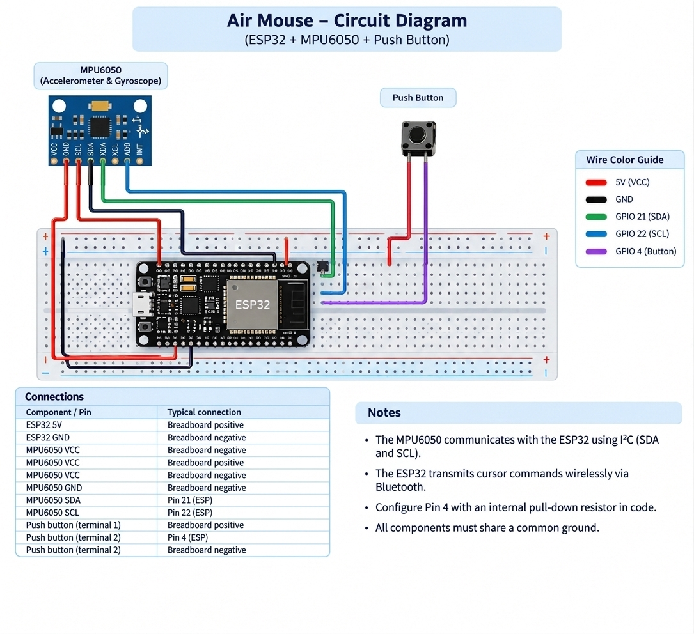

Air Mouse
Aim
To control a computer cursor using hand movements and Bluetooth communication.
What is the project?
A motion-controlled input device that allows the user to move a cursor without a conventional computer mouse.
How does it work?
The MPU6050 measures acceleration and angular movement using its accelerometer and gyroscope.
The ESP32 reads these measurements and processes them using its program.
The program converts detected movements into cursor movement or other mouse commands.
The ESP32 transmits commands to a compatible device using Bluetooth.
The device interprets the commands to control the cursor. Clicking works only if it has been programmed.
Components used
ESP32 microcontroller
MPU6050 accelerometer and gyroscope module
Push button (2 terminals)
Breadboard
Jumper wires
Bluetooth-compatible computer or other device
Circuit Diagram

Connections
Component / Pin	Typical connection
ESP32 5V	Breadboard positive
ESP32 GND	Breadboard negative
MPU6050 VCC	Breadboard positive
MPU6050 GND	Breadboard negative
MPU6050 SDA	Pin 21 (ESP32)
MPU6050 SCL	Pin 22 (ESP32)
Push button (terminal 1)	Breadboard positive
Push button (terminal 2)	Pin 4 (ESP32)
Important wiring notes
Check the MPU6050 breakout-board voltage requirements before connecting VCC.
Confirm that the push-button wiring matches the program's input logic. A pull-down or pull-up arrangement may be required.
The diagram is an illustrative reference; verify actual module pin labels before powering the circuit.
